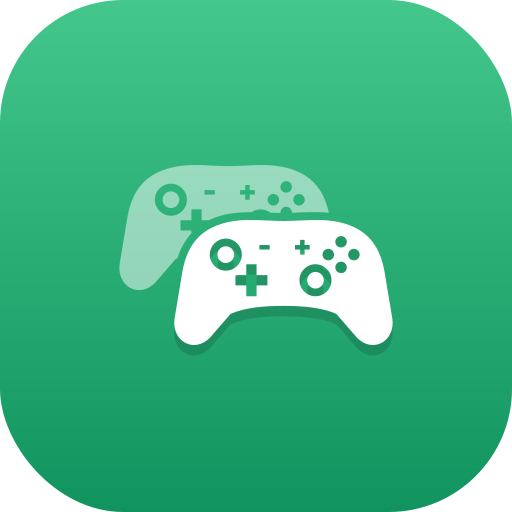
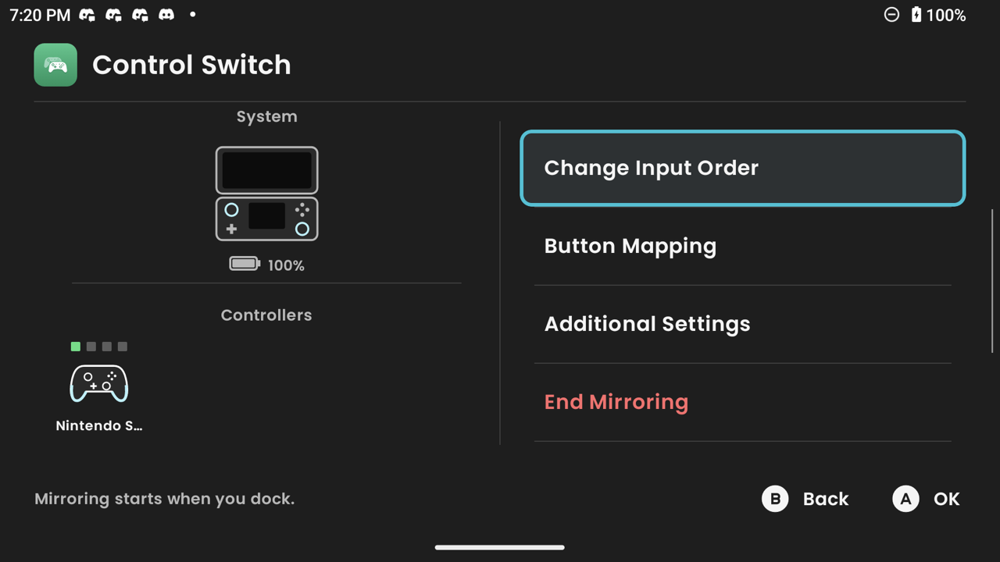
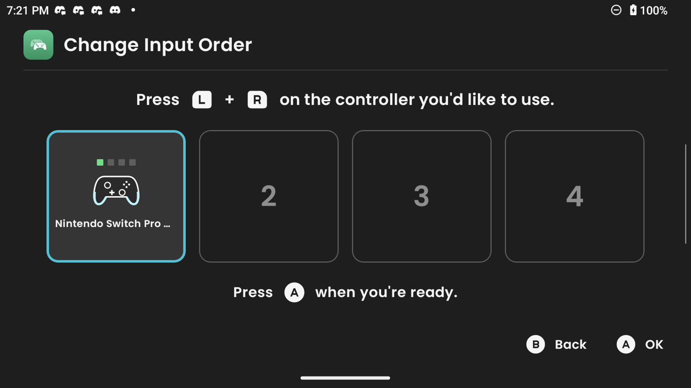
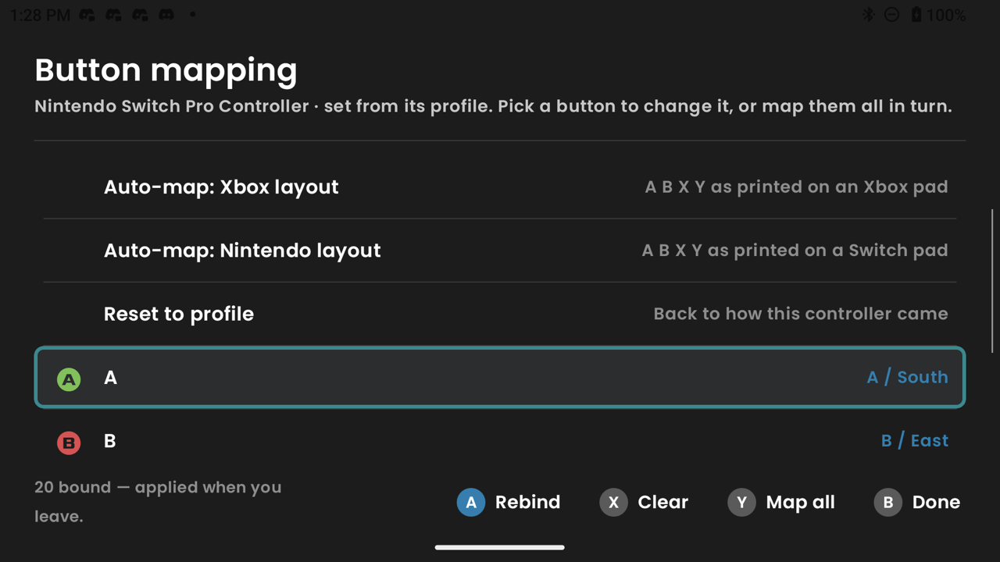
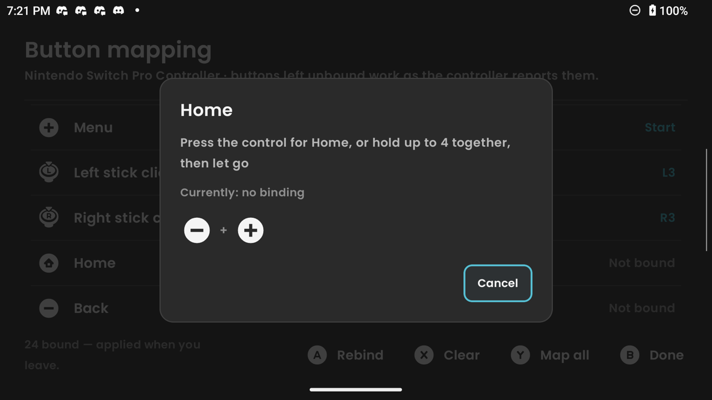
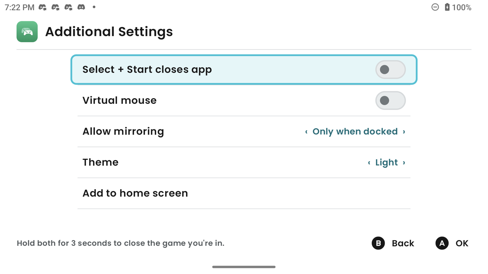

<div align="center">



# Control Switch for AYN Thor

**Play docked with the controller in your hands — no remapping, no root.**


A fork of [Ezequiel-CE/Docking-Enhancer](https://github.com/Ezequiel-CE/Docking-Enhancer), the Odin 2
app, retargeted to the AYN Thor and renamed Control Switch.

<br>



<table>
<tr>
<td></td>
<td></td>
</tr>
<tr>
<td align="center">Press <b>L + R</b> to pick player 1</td>
<td align="center">Bind any button, or a combination</td>
</tr>
<tr>
<td></td>
<td></td>
</tr>
<tr>
<td align="center">Hold buttons together, then let go</td>
<td align="center">Dark, Super dark or Light</td>
</tr>
</table>

</div>

## New in 0.4.0

- **Button combinations** — bind Home, Back or any button to 2–4 controller buttons held together
- **Themes** — Dark, Super dark and Light, with a teal focus outline you can follow from the couch
- **Console-matched button prompts** — Xbox icons, or Switch icons once you pick the Nintendo layout
- **New app icon**

## What it does

Dock your handheld to a TV and games still expect its *built-in* controller, not the pad you're
actually holding — so every session starts with remapping. Control Switch grabs your external
controller and replays its input onto the internal controller's input device, so everything just
sees the built-in pad. Nothing to remap, ever. It can do the same undocked, whenever a controller
is connected.

It runs without root, using a privileged service the stock firmware already ships.

## Features

- **Automatic** — mirrors **Only when docked** or **Always when a controller is connected**, your
  choice, and survives reboots
- **Player 1 lock** — press **L + R** on the controller you want, Switch-style. Once locked, only
  that pad is mirrored, whenever it's connected. Identical pads are told apart while connected
- **Home button that goes Home** — the external pad's Home/Guide button goes to the launcher, or
  Back, or passes through to games. Hold it for **Recents**
- **Home and Back on any button** — bind either to a pad button, or to a combination, in the
  mapping editor
- **Button combinations** — any button, Home and Back included, can be bound to 2–4 buttons held
  together. Hold them, let go, done; the held buttons show as icons while you do it. When a
  combination fires, its buttons don't also reach the game
- **Select + Start** — hold it (3s) to close the current app
- **Hides the external pad** while mirroring, so games see one controller instead of a phantom player 2
- **Guided button mapping** — press a button for each row, or let **Map all** walk the list; or pick
  **Nintendo** or **Xbox** layout to map in one go. Triggers and stick halves can fill button
  slots, and untouched controls keep working. Pads the bundled
  [SDL database](third-party/gamecontrollerdb/NOTICE.md) knows arrive already mapped, using the
  entry that fits the pad's driver
- **Virtual mouse** — Select + R3 turns the pad into a pointer for tapping through Android UI
- **Nintendo layout aware** — swaps A/B and X/Y when the built-in pad is in its Nintendo profile
- **Controller-first UI** — Switch-style screens with a button-hint bar; set it up without touching
  the screen
- **Themes** — Dark, Super dark or Light, in Additional Settings
- **Button prompts that match your pad** — Xbox Series icons by default, Nintendo Switch 2 icons
  once you apply the Nintendo layout
- **Add to home screen** — for game frontends like Cocoon Shell that hide the Android app list
- **~0.04 ms of added latency** (median) — a fraction of one 60Hz frame
  ([measured](docs/TECHNICAL.md#latency); re-measured on a Thor, see [Building](#building))

## Install

Updating from Control Switch 0.3.0? Just install over it; settings and mappings carry over.

Coming from Docking Enhancer v0.2.0? Uninstall it first. The app id changed (now
`com.controlswitch`), so the new version installs as a separate app instead of upgrading, and two
copies would fight over the controller. Settings don't carry over.

1. Install the APK from this fork's [Releases](https://github.com/CardinalBird/docking-enhancer-Thor/releases)
   (allow "unknown sources" if prompted), or build it yourself — see [Building](#building).
   Upstream's releases don't include the Thor changes.
2. Open it once and allow notifications. Under **Additional Settings → Allow mirroring**, choose
   **Only when docked** or **Always** (whenever a controller is connected).
3. Pair a controller (and dock, if you chose docked only). It takes over on its own.
4. Optional: with more than one pad, open **Change Input Order** and press **L + R** on yours,
   then **A**. On a frontend launcher, use **Add to home screen** to pin the app.

## Supported devices

| Device | Status |
| --- | --- |
| **AYN Thor** | Tested (Android 13, firmware `Thor_V1.0.0.377`) — primary target of this fork |
| AYN Odin 2 / Portal | Upstream's target; not re-tested with this fork's changes |
| AYN Odin 2 Mini | Not supported — [ships the service but it doesn't respond](docs/TECHNICAL.md#the-odin-2-mini) |
| Other handhelds with `PServerBinder` | Likely work, untested |

Support is decided at runtime by whether the firmware's service actually answers — not by a model
list — so any handheld with a working one has a good chance. Devices without it are told so instead
of silently doing nothing.

## On the Thor

What's different from the Odin, all found on a real device:

- **The bottom screen isn't a dock.** It's a second, always-on display, so it's ignored when
  deciding whether you're docked; only an external display counts.
- **The built-in pad** reports as "Odin Controller" (`2020:0111`), so it's detected automatically.
- **Only one external pad is taken over by the firmware.** The Thor re-registers one connected pad
  under its own ID; that's the one the app can hide. If your locked player 1 is a *second* pad, the
  first stays visible to games as player 2 while mirroring.
- **Locks are remembered by name across reconnects.** Two identical pads (two Pro Controllers) are
  told apart while connected; after both reconnect, the lock may land on either. The Pro
  Controller doesn't expose its Bluetooth address to the system.
- **Recents** opens when Home is released after a long hold, not at the moment the hold counts.

Tested handheld and on a real HDMI dock, with a Nintendo Switch Pro Controller and an 8BitDo
Ultimate 2 (Switch mode) over Bluetooth.

## How it works

A small native daemon reads the external controller, grabs it exclusively, and replays every event
onto the internal controller's `/dev/input` node. While mirroring it also unlinks the external pad's
node so Android drops it from the device list, and puts it back on exit.

Privileged work goes through the stock firmware's `PServerBinder` service via a raw binder
transaction — the same no-root technique used by ClusterTune and PULSE.

Details, design notes and the build instructions live in **[docs/TECHNICAL.md](docs/TECHNICAL.md)**.

## Building

Needs JDK 21 for Gradle (the project compiles for Java 17), the Android SDK (compile SDK 35) and an
NDK (26.3 used here). On macOS or Linux:

```sh
# Native daemon -> android/app/src/main/assets/input_mirror/ (commit it with its source)
ANDROID_NDK_HOME=/path/to/ndk scripts/build-input-mirror.sh

# Unit tests and a debug APK
cd android
./gradlew :domain:test :data:testDebugUnitTest :app:testDebugUnitTest :app:assembleDebug
adb install -r app/build/outputs/apk/debug/app-debug.apk
```

On Windows, use `scripts/build-input-mirror.ps1` and `gradlew.bat`. Debug builds act as if always
docked (`FORCE_DOCK_MODE_FOR_DEV` in `android/app/build.gradle`) so the mirror can be tested at a
desk; release builds use real dock detection. Debug and release are signed differently, so
switching between them means an uninstall, which resets the app's settings.

On-device tests drive synthetic controllers, so no physical pad is needed:

```sh
ANDROID_NDK_HOME=/path/to/ndk .claude/skills/mirror-e2e/scripts/build-harness.sh
adb shell sh /data/local/tmp/e2e.sh
adb shell sh /data/local/tmp/latency.sh 300
```

The Thor has no root shell, so the three assertions that unlink device nodes directly fail there by
design; the app itself does that step through `PServerBinder`. On a Thor the rest of the suite
passes (81 of 84), and the latency run gives a median of ~0.04 ms added (65 µs mirrored against
22 µs without the daemon). Its slowest 5% are higher (~0.4 ms) because the test daemon runs at
normal priority; the app's runs at high priority.

## Credits

This is a fork of [**Docking Enhancer**](https://github.com/Ezequiel-CE/Docking-Enhancer) by
Ezequiel-CE, which did the hard part: the daemon, the no-root plumbing and the mapping system.

The no-root PServer technique comes from [**ClusterTune**](https://github.com/AurelioB/ClusterTune),
and the `PServerBinder` access code is adapted from [**PULSE**](https://github.com/keiretrogaming/pulse).
Button prompts are [Kenney Input Prompts](https://kenney.nl/assets/input-prompts) (CC0).
Full third-party notices in [NOTICE.md](NOTICE.md).

Built with heavy help from an AI coding assistant (Anthropic's Claude), always directed and reviewed
by the maintainers — every change compiled, unit-tested and confirmed on a real handheld before
shipping. Spelled out here for transparency.

Not affiliated with AYN.

## License

[GNU General Public License v2.0](LICENSE). Please keep the attribution above intact in any fork —
the GPL requires it.
